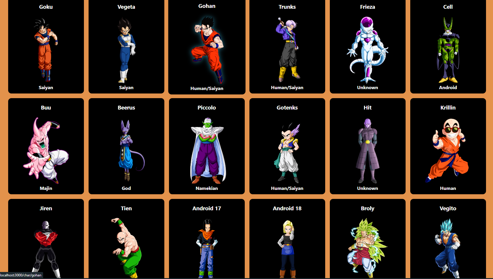

# Dragon Ball Info

     

## 📖 Descrição:
Este projeto é uma página inspirada na famosa franquia Dragon Ball, desenvolvida com o objetivo de praticar minhas habilidades com React Routes e o consumo de dados com JSON. O foco foi criar uma página funcional e responsiva, proporcionando uma boa experiência para o usuário.

## 🚀 Tecnologias Utilizadas:
✅ React Routes – Criação de rotas na aplicação. 
✅ React – Framework para criação de interfaces de usuário dinâmicas.
## ⚡ Como Rodar o Projeto:
1. Clone este repositório
2. Entre no diretório
3. Caso ja tenha o node.js instalado basta digitar no prompt: 
   . npm install 
   . npm start